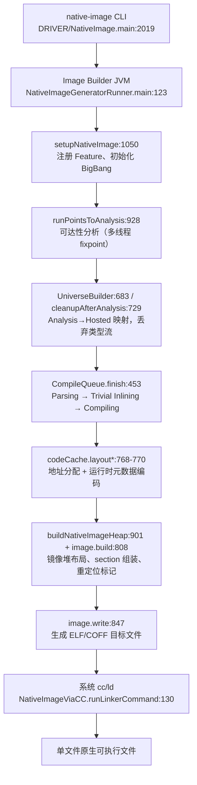

# Native Image 编译流程与增量编译可行性研究

> 研究对象：本仓库源码，分支 `release/graal-vm/25.4`（GraalVM 25.4.4.1.1，commit `95ce1499`）。
> 本文是源码研究报告，不是 GraalVM 用户文档。所有结论尽量给出源码路径与行号；未能从源码证实或需要实验验证的内容均明确标注。行号基于当前分支，向上游合并后可能漂移。

路径缩写约定：

- `DRIVER` = `substratevm/src/com.oracle.svm.driver/src/com/oracle/svm/driver`
- `SVM-HOSTED` = `substratevm/src/com.oracle.svm.hosted/src/com/oracle/svm/hosted`
- `SVM-CORE` = `substratevm/src/com.oracle.svm.core/src/com/oracle/svm/core`
- `POINTSTO` = `substratevm/src/com.oracle.graal.pointsto/src/com/oracle/graal/pointsto`
- `GRAAL` = `compiler/src/jdk.graal.compiler/src/jdk/graal/compiler`

证据等级标注：

- **[A]**：作者逐行阅读源码核实（`CompileQueue.java` 全文、`AnalysisMethod.java` 图 API、套件装配、布局/链接锚点等）。
- **[B]**：由独立检索得出，且与已核实代码交叉一致。
- **[C]**：单一来源检索结果，未经二次复核，采信前建议再验证。

---

## 0. 摘要：三个核心问题的直接回答

**问题一：CompileQueue 到底掌握了多少编译上下文？**

比"调度器"多得多，但比"全知者"少一点。`CompileQueue` 持有每个方法的编译任务、编码后的方法图（含调用边与分配点信息）、编译原因链和最终 `CompilationResult`（[A]）。它自己完成图移植、图编码、trivial 内联、编译传播。它**不掌握**的只有两块：可达性分析的语义（类型流、实例化集合——这些在分析阶段已经固化为 `getImplementations()` 等查询接口）和镜像布局（地址分配在 `NativeImageCodeCache`）。

结论：**CompileQueue 是编译结果缓存最自然的插入点**，但正确的缓存失效判定必须同时上溯到分析层（类型图是否变化）并下探到布局层（地址无关性是否成立）。

**问题二：重复编译究竟发生在哪里？**

- 跨构建：**100% 重复**。分析、图构建、优化、布局全部从零开始。本仓库普通单文件构建中不存在任何跨构建持久化机制（无 `CompilationCache`、无 `CompilationResult` 序列化；唯一持久化复用机制 Native Image Layers 与单文件输出互斥）[A][B]。
- 单次构建内：没有重复"编译"（`compilations` map 保证每方法恰好一次），但存在**大量重复"解码"**——每个方法图在 trivial 内联阶段可能被多轮解码，编译阶段再解码一次；字节码则只解析一次（分析期）[A]。
- 一个关键结构性结论：**编译耗时的大头在优化阶段，而优化阶段的输出终点就是机器码**。因此有意义的跨构建缓存只有两个端点——"分析结果/解析图"与"`CompilationResult`（机器码）"；中间态 IR 缓存（如优化后 HighTier IR）被 `CompilationResult` 缓存支配：失效语义相同、序列化更复杂、还要重跑后续阶段。详见第 5.2 节。

**问题三：有没有足够小、足够安全的切入点？**

有。按风险从低到高：① 消除单次构建内的重复图解码（纯内部优化，不改语义）；② 受限白名单的方法级 `CompilationResult` 持久化缓存（先覆盖"叶子方法 + 从未被内联 + 无虚调用目标集合变化"的方法）；③ 借鉴 Layers 已有的图持久化设施（`ImageLayerGraphStore`、`LayerArchiveSupport`）逐步扩展。第 8、9 节给出实验与排序。

---

## 1. 编译架构（任务一）

### 1.1 进程模型：一次构建涉及三个进程

| 进程 | 入口 | 职责 |
| --- | --- | --- |
| `native-image` CLI（driver） | `DRIVER/NativeImage.java:2019` `main` → `performBuild:2023` → `build:2044` | 解析选项、拉起 image builder 子进程、等待、驱动链接 |
| Image Builder（独立 JVM） | `SVM-HOSTED/NativeImageGeneratorRunner.java:123` `main` → `start:144` → `build:186` → `buildImage:517` | 类加载、可达性分析、编译、镜像生成与目标文件写出 |
| 系统 cc/ld | `SVM-HOSTED/image/NativeImageViaCC.java:130` `runLinkerCommand`（`linkerCommand.start():139`，`waitFor():152`） | 链接生成最终可执行文件 |

driver 通过 `--module <builder模块>/com.oracle.svm.hosted.NativeImageGeneratorRunner` 拉起子进程（`DRIVER/NativeImage.java:121-122`、`:1698`），参数经两个 @argfile 传递（`:1731-1732`），`ProcessBuilder` 启动并等待退出（`:1771-1826`，记录 `imageBuilderPid :1825`）[A][B]。

注意一个容易被忽略的 driver 级细节：`DRIVER/NativeImage.java:2089-2092` 存在 `REBUILD_AFTER_ANALYSIS` 分支，特定选项组合下 driver 会带标记参数重跑一次 image builder，即**极端情况下存在"driver 层的二次完整构建"**。具体触发选项集合未逐一确认 [C]。

### 1.2 Image Builder 内的阶段流水线

主线在 `SVM-HOSTED/NativeImageGenerator.java`（以下同文件仅给行号），`run:552` → `doRun:650`，顺序如下 [A]：

| # | 阶段 | 方法 / 行号 | 说明 |
| --- | --- | --- | --- |
| 1 | 初始化 | `setupNativeImage:658`（实现 `:1050`） | `registerFeatures:1110` 注册 Feature → `afterRegistration:1119` → `duringSetup:1247` → `initializeBigBang:1251` |
| 2 | 可达性分析 | `runPointsToAnalysis:660`（实现 `:928`） | `ProgressReporter.printAnalysis` 从 `:952` 开始；`:965` `bb.runAnalysis(...)`，期间反复回调 Feature 的 `duringAnalysis`；`:998` `afterAnalysis` |
| 3 | Universe 构建 | `:681`-`:729` | `beforeUniverseBuilding:681` → `UniverseBuilder#build:683`（Analysis 元素 → Hosted 元素映射）→ `HostedRuntimeConfigurationBuilder#build:689`（Providers/Backend 装配）→ `bb.cleanupAfterAnalysis():729`（丢弃类型流） |
| 4 | 编译前 | `:743`-`:745` | `feature.beforeCompilation:743` |
| 5 | **编译** | `:750`-`:756` | `createCompileQueue:750` → `compileQueue.finish(debug):754` → `runOnExecutor(afterCompileQueue):756` → `feature.afterCompilation:775` |
| 6 | 代码布局 | `:765`-`:770` | `newCodeCache:766` → `layoutConstants:768` → `layoutMethods:769` → `buildRuntimeMetadata:770` |
| 7 | 镜像堆 | `:792`-`:800` | `beforeHeapLayout:792` → `buildNativeImageHeap:796`（实现 `:901`）→ `afterHeapLayout:800` |
| 8 | 镜像构建 | `:802`-`:808` | `createAbstractImage:802` → `image.build(imageName, debug):808` |
| 9 | 写出与链接 | `:838`-`:856` | `beforeImageWrite:838` → `image.write(...):847`（返回 `LinkerInvocation`）→ 链接 → `afterImageWrite:856` |
| 10 | 收尾 | `:873` | `printCreationEnd`（报告代码大小、堆大小、编译方法数） |

### 1.3 流程图



### 1.4 Feature 生命周期与阶段边界

Feature 回调顺序定义在 `sdk/src/org.graalvm.nativeimage/src/org/graalvm/nativeimage/hosted/Feature.java`（[A]，行号）：`onRegistration:617` → `afterRegistration:628` → `duringSetup:639` → `beforeAnalysis:649` → `duringAnalysis:663`（可迭代）→ `afterAnalysis:673` → `beforeUniverseBuilding:695` → `beforeCompilation:705` → `afterCompilation:715` → `beforeHeapLayout:725` → `afterHeapLayout:738` → `beforeImageWrite:749` → `afterImageWrite:759` → `cleanup:771`。分发器为 `SVM-HOSTED/FeatureHandler.java`。

与本次研究直接相关的两个进度阶段，在 25.4 中的用户可见文案与代码边界 [A]（`SVM-HOSTED/ProgressReporter.java`）：

- 分析阶段：`BuildStage.ANALYSIS("Performing analysis")`（`:158`）。注意：25.4 的阶段文案是 "Performing analysis"，旧版资料中的 "Reachability Analysis" 字样只出现在 `ReachabilityTracePrinter` 等诊断输出里。边界 = `runPointsToAnalysis` 内 `:952`-`:1009`。
- 编译阶段：`BuildStage.PARSING("Parsing methods"):160`、`INLINING("Inlining methods"):161`、`COMPILING("Compiling methods"):162`。三者都发生在 `CompileQueue.finish`（`SVM-HOSTED/code/CompileQueue.java:453`）内部，即用户观察到的 "Compiling Methods" 阶段对应 `compileAll()`（`CompileQueue.java:494`）。

### 1.5 从编译完成到可执行文件

`image/NativeImage.java:507` `build()` 的步骤 [A][B]：建立 text/rodata/data 三个 `RelocatableBuffer` → `NativeImageHeapWriter:557` → `textImpl.writeTextSection:560`（内部先 `codeCache.patchMethods` 再 `writeCode` 拷入机器码）→ `codeCache.writeConstants:562` → `cGlobals.writeData:564` → 单独的 SVM_HEAP section `writer.writeHeap:584` → 对四个 buffer 统一 `markRelocationSitesFromBuffer:641-644`。之后 `image/NativeImageViaCC.java:90` `write()` 生成原生目标文件（ELF/COFF `.o`，非汇编 blob），`:116` 组装链接命令并执行。

---

## 2. Compiling Methods 深度分析（任务二）

本章基于对 `SVM-HOSTED/code/CompileQueue.java`（1715 行）的全文精读 [A]，辅以协作类的检索验证 [B]。

### 2.1 CompileQueue 持有的状态

| 字段 | 行号 | 含义 |
| --- | --- | --- |
| `compilations: ConcurrentMap<HostedMethod, CompileTask>` | `:203` | 全部编译任务，同时是去重表；key 为方法 |
| `executor: CompletionExecutor` | `:202`，构造 `:432` | 并行执行器，底层是 `ForkJoinPool.commonPool()` [A]（`POINTSTO/util/CompletionExecutor.java:152,208`） |
| `runtimeConfig` / `metaAccess` / `policies` | `:204-205,:201` | 全局 Providers 与编译策略钩子 |
| `regularSuites` 等 8 个 Suites/LIRSuites 字段 | `:206-213` | 全局共享的优化套件（创建于 `createSuites:526-540`） |
| `graphTransplanter: AnalysisToHostedGraphTransplanter` | `:217` | 分析图 → 编译图的移植器 |
| `unpublishedTrivialMethods` | `:234` | trivial 内联结果的批量发布缓冲（保证并发确定性，`:966-973` 注释） |

编译任务本体 `CompileTask`（`:341-372`）：`method` + `reason`（编译原因链）+ `result`（`CompilationResult`）+ `compilationIdentifier`。`ParseTask`（`:395-421`）与 `TrivialInlineTask`（`:374-393`）是另两类任务。

**对核心问题的一半回答**：CompileQueue 同时掌握编译输入（编码图）、调用边（`CompilationGraph.invokeInfos`）、编译原因（`CompileReason` 链）和编译结果（`task.result`），并通过 `getCompilationResults():1704-1710` 将全部结果交给 `LIRNativeImageCodeCache`（`SVM-HOSTED/HostedConfiguration.java:401-402`）[A]。它缺的只是分析语义与布局。

### 2.2 finish() 的三段式流水线

`finish(DebugContext)`（`CompileQueue.java:453-511`）顺序执行 [A]：

1. **Parsing**（`:457-459` → `parseAll:734-742`）：先解析 AOT 方法（`parseAheadOfTimeCompiledMethods:749`），再解析 deopt 目标（`parseDeoptimizationTargetMethods:806`）。解析的种子是入口点：`hMethod.isEntryPoint() || isForcedCompilation || (isDirectRootMethod && isSimplyImplementationInvoked)`（`:774-777`）以及虚根方法的全部实现（`:778-783`）、foreign call 根（`:787-799`）。其余方法通过图内 invoke **传播式解析**（`defaultParseFunction:1223-1229` → `ensureParsed:1261-1283`：间接调用对 `getImplementations()` 逐个入队，直接调用需分析侧确认 `isSimplyImplementationInvoked`）。
2. **Trivial Inlining**（`:483-485` → `inlineTrivialMethods:825-853`）：多轮循环，每轮对所有已编码方法做解码期内联（`doInlineTrivial:926-980`），轮末统一发布结果（`:844-851`），直到无新进展。
3. **Compiling**（`:491-496`）：`createSuites():526` 创建全局套件 → `compileAll():1058-1067` 先调度入口点（`scheduleEntryPoints:1075-1112`）再调度 deopt 目标（`scheduleDeoptTargets:1119-1132`）；之后由编译任务在完成时继续传播新任务（见 2.5）。

此外 `finish()` 在解析后做注解检查（`:461-469`）并**清空所有分析期图**（`:476-478` `clearAnalyzedGraph()`）——分析图在移植后即被释放，印证"图在构建内是一次性资源"。

### 2.3 方法图的生命周期：字节码只解析一次，图被多次编码/解码

这是理解编译成本与缓存可行性的关键链路 [A][B]：

```
字节码 ──(分析期, SubstrateBytecodeParser 解析一次)──▶ StructuredGraph
   POINTSTO/meta/AnalysisMethod.java:1069 ensureGraphParsed
   解析器: SVM-HOSTED/phases/SubstrateGraphBuilderPhase.java:49 (SubstrateBytecodeParser)
        │  GraphEncoder.encodeSingleGraph 编码缓存 (AnalysisMethod: setAnalyzedGraph:1411)
        ▼
   AnalysisMethod.parsedGraphCacheState (AtomicReference<GraphCacheEntry>, :190)
   两阶段图缓存状态机: UNPARSED/parsing/parsed/cleared (AnalysisMethod.java:1099-1307)
        │  编译期: AnalysisToHostedGraphTransplanter.transplantGraph
        │  (SVM-HOSTED/code/AnalysisToHostedGraphTransplanter.java:88-140:
        │   解码分析图、Analysis*→Hosted* 对象替换、EA 状态修补, 然后释放分析图 :99)
        ▼
   after-parse canonicalization (CompileQueue.afterParseCanonicalization:624-637)
        │  CompilationGraph.encode → 编码图 + invoke 边 + 分配点 (CompilationInfo.encodeGraph:134-136)
        ▼
   CompilationGraph (SVM-HOSTED/code/CompilationGraph.java:92-125)
        │  之后 trivial inlining 与正式编译都从这里解码
        ▼
   CompilationInfo.createGraph (SVM-HOSTED/code/CompilationInfo.java:110-132, GraphDecoder)
        │  CompileQueue.defaultCompileFunction:1535 调用
        ▼
   GraalCompiler.compile (CompileQueue.defaultCompileFunction:1593-1604)
```

要点：

- **编译期不接触字节码**。字节码只在分析期由 `SubstrateBytecodeParser` 解析一次（`POINTSTO/meta/AnalysisMethod.java:1245` `CREATE_FIRST_STAGE` → `AnalysisParsedGraph.parseBytecode`）[B]。
- 分析图与编译图是**同一份**：编译期通过 `decodeAnalyzedGraph`（`AnalysisMethod.java:1370`）+ `AnalysisToHostedGraphTransplanter`（Analysis 对象→Hosted 对象全量替换，含 Stamp、NodeSourcePosition、字段布局修补）获得，移植后立即 `clearAnalyzedGraph:99` 释放 [A]。
- 编码后的 `CompilationGraph` 不仅存图，还记录每个 invoke（`InvokeInfo`：invoke kind + 目标方法 + caller）和分配点（`AllocationInfo`）——**这是仓库现成的"方法调用边"元数据**，对缓存失效追踪直接有用（见 5.4）。

### 2.4 编译任务粒度（问题 1、2、3）

**最小编译任务粒度是 `HostedMethod`（方法变体），不严格等于 Java 方法。** 每个 `CompileTask` 恰好编译一个 `HostedMethod`，每方法恰好一个任务（`compilations.putIfAbsent` 去重，`ensureCompiled:1450-1454`）[A]。

一个 Java 方法可能对应多个编译任务，来源 [A][B]：

1. **Deopt target 方法变体**：`MethodVariant` 机制为同一 Java 方法生成 `DEOPT_TARGET_METHOD` 变体（独立 `HostedMethod`），在 `scheduleDeoptTargets:1119-1132` 单独编译，服务于运行时可重优化/PGO 场景。这是"同一 Java 方法两个编译任务"的最主要来源。
2. **Fallback 重试**：`doCompile:1495-1522` 编译失败时用 `fallbackSuites` 对同一方法再编译一次（串行重试，非并行重复）。
3. **`compileAdditionalMethod:1491-1493`**：额外编译结果不进 `compilations` map，用于特殊场景。
4. **合成方法**：`CEntryPointCallStubMethod`、`CCallStubMethod`、`CFunctionCallStubMethod`、`IncompatibleClassChangeFallbackMethod`、字节码 handler stub（`SubstrateBytecodeHandlerStub`）以及构建期生成的 lambda/proxy/MethodHandle 类的方法，都是独立 `HostedMethod`，各自一个任务 [B]。
5. **`@Specialize` 参数特化**：不产生新任务——常量替换发生在同一任务的图定制阶段（`handleSpecialization:1388-1405`、`defaultCompileFunction:1543-1552`）。

相反方向（一个任务对应多个 Java 方法）也存在：trivial 内联把 callee 的图展开进 caller 的图，被完全内联的方法**没有**独立 `CompilationResult`（见 2.6）。

### 2.5 任务间依赖与传播（问题 4）

编译任务之间**没有执行顺序依赖**——所有任务可并行，依赖只体现为"任务产生任务"的传播 [A]：

| 传播时机 | 代码 | 触发新任务的条件 |
| --- | --- | --- |
| 解析期 | `defaultParseFunction:1223-1240` → `ensureParsed:1261-1283` | 图内每个 invoke：间接调用解析其全部 `getImplementations()`，直接调用解析目标（需 `isSimplyImplementationInvoked`） |
| 编译期 | `ensureCalleesCompiled:1651-1668` | 扫描 `CompilationResult` 的 Call infopoint：direct → 编译目标（`:1656`）；虚调用 → 编译全部实现（`:1661-1663`） |
| 编译期 | `ensureCompiledForMethodRefConstants:1686-1702` | DataPatch 中的 `SubstrateMethodPointerConstant`/`SubstrateMethodOffsetConstant` 引用的方法 |

含义：**最终编译集合不是分析阶段的输出，而是"从入口点出发、沿编译产物中真实存在的调用边传播的闭包"**。分析结果只提供虚调用的可能目标集合（`getImplementations()`，源自 `POINTSTO/meta/AnalysisMethod.java:902-930` `collectMethodImplementations`，基于 `allImplementations` 过滤出 `isImplementationInvoked()` 的方法）[B]。因此存在"解析了但从未编译"的方法——所有调用点都被内联掉的方法（解析是解析传播的必要条件，因为内联决策在每个 caller 解码时才发生）。

### 2.6 跨方法内联（问题 5）

SVM hosted 编译**移除了 Graal 标准 `InliningPhase`**：`NativeImageGenerator.modifySuites` 中 `highTier.removePhase(AbstractInliningPhase.class)`（`SVM-HOSTED/NativeImageGenerator.java:1850`，注释明确指出 SVM 有自己的内联体系），换装 `SubstratePriorityInliningPhase`（`:1852` → `SVM-HOSTED/HostedGraalConfiguration.java:87-102`）[A]。实际存在两套内联 [A]：

1. **Trivial inlining（默认开启）**：`SubstrateOptions.AOTTrivialInline`（`SVM-CORE/SubstrateOptions.java:987`，默认 true）。发生在图**解码期**：`InliningGraphDecoder extends PEGraphDecoder`（`CompileQueue.java:874-903`），`lookupEncodedGraph:885-887` 直接取被内联方法的编码图。判定 `makeInlineDecision:982-1005`：`@AlwaysInline`/`@ForceInline`（`HostedMethod.shouldBeInlined:597`）或 trivial 方法（`InliningUtilities.isTrivialMethod`，阈值：非叶子方法 ≤20 节点且 ≤1 个 invoke，叶子 ≤40 节点；`SubstrateOptions.java:997,1000,1003`）。内联后超限可整体禁用（`MaxNodesAfterTrivialInlining:1006`，默认 `Integer.MAX_VALUE` 即无上限）。被内联方法不重新解析字节码、不独立优化，其调用边从 caller 的 `CompilationResult` 中消失。
2. **Priority inlining（O2/O3 默认开启）**：`SubstrateOptions.AOTPriorityInline`（`:338`，O2/O3 启用；默认优化级别是 O2，`SubstrateOptions.java:455`）。在 HighTier 内作为独立 phase 对每个方法执行（`SVM-HOSTED/phases/priorityinline/SubstratePriorityInliningPhase.java:100`），同样从编码图解码展开。

**不存在过程间数据流优化**：内联只是"把 callee 图嵌入 caller 图后统一优化"，各方法的优化彼此独立、不共享中间状态；唯一的全局共享是套件（Suites）与 Providers（只读）[A]。

### 2.7 全局优化与共享编译状态（问题 6）

- **共享（只读）**：8 个全局 Suites（`CompileQueue.java:206-213`）、Providers（`HostedMetaAccess`/`HostedUniverse`/`SubstrateBackend` 等，装配于 `SVM-HOSTED/code/SharedRuntimeConfigurationBuilder.java:87-145` 与 `HostedRuntimeConfigurationBuilder.java:71-101`）[B]。
- **共享（并发写）**：`CompilationInfo`（每方法状态：编码图、trivial 标志、统计）与 `unpublishedTrivialMethods` 批量发布机制（`CompileQueue.java:844-851`，注释 `:966-973` 说明是为避免并发下内联结果非确定性）[A]。
- **编译间无跨方法共享的优化结论**：没有"编译完 A 后，B 复用 A 的任何优化产物"的机制。

### 2.8 并行调度（问题 8）

- 执行器是 `CompletionExecutor`，任务提交到 `ForkJoinPool.commonPool()`，以 `awaitQuiescence` 等待静止（`POINTSTO/util/CompletionExecutor.java:152,208`）[A]。
- 并行度由 `NativeImageOptions.NumberOfThreads`（`SVM-HOSTED/NativeImageOptions.java:202`，CLI 名 `--parallelism`）控制，**默认 `min(CPU 核数, 32)`**；它通过设置 common pool 的 parallelism 生效（`NativeImageGeneratorRunner.java:422`）[B]。
- 无拓扑排序、无优先级调度：任务入队顺序由传播顺序决定，完成顺序不确定；`finish()` 中以多次 quiescence 屏障分阶段（解析两段、内联每轮一段、编译两段）[A]。
- 分析阶段同样用 `CompletionExecutor` 多线程执行类型流 fixpoint（`POINTSTO/PointsToAnalysis.java:608-654`）[B]。注意：旧选项 `NumberOfAnalysisThreads` 已 deprecated（`NativeImageOptions.java:239`）[B]。

### 2.9 编译产物（问题 9、10）

每个任务产出一个 `CompilationResult`（`GRAAL/code/CompilationResult.java`；25.4 中 Graal 包名已从 `org.graal.compiler` 更名为 `jdk.graal.compiler`）[A][B]：

| 内容 | 字段（行号） | 说明 |
| --- | --- | --- |
| 机器码 | `targetCode: byte[]`（:249）、`targetCodeSize`（:254） | 编译期只含相对偏移，绝对地址后置 |
| Data section | `dataSection`（:219）、`dataPatches`（:224） | 常量与 `DataPatch`（`ConstantReference` 指向 Java 常量对象） |
| Infopoints | `infopoints`（:222） | Call/Safepoint + `DebugInfo`（FrameState，deopt 元数据来源） |
| 异常表 | `exceptionHandlers`（:225） | pcOffset + handlerPos |
| 内联记录 | `methods`（:265） | root 方法 + 被内联方法数组 |
| 其他 | `assumptions`（:258）、`sourceMapping`、`annotations`（含 SVM 专有 `HostedImageHeapConstantPatch`） | hosted AOT 场景 assumptions 实际用途未确认 [C] |

结果的去向（全部在 `LIRNativeImageCodeCache`，`SVM-HOSTED/image/LIRNativeImageCodeCache.java`）[A]：

1. `layoutMethods:138-214`：按布局器顺序对齐、`method.setCodeAddressOffset(curPos):156` 分配最终代码偏移，AArch64 插入直接调用 trampoline；
2. `layoutConstants`/`buildRuntimeMetadata`（`NativeImageCodeCache.java`）：合并 DataSection、`CodeInfoEncoder`（`SVM-CORE/code/CodeInfoEncoder.java`）编码 deopt/异常/引用映射元数据；
3. `patchMethods:324-364`：`processDirectCallSites:385-408` 以 `pcDisplacement = callTargetStart - (compStart + call.pcOffset)` 就地修补直接调用；`processDataPatch` 把 DataPatch 转为镜像重定位条目；
4. `writeCode:454-458`：机器码拷入 `.text`。

### 2.10 Graal 编译器内部：一个方法的完整优化管线（问题 7）

入口：`CompileQueue.defaultCompileFunction:1524` → `GRAAL/core/GraalCompiler.java:145` `compile(Request)` → `emitFrontEnd:267`（High/Mid/Low 三 tier，`:283/:288/:293`）→ `emitBackEnd`（`:153`，LIR + 机器码）[A]。

套件装配：`CompileQueue.createSuites:526` → `NativeImageGenerator.createSuites:1789-1798`（`GraalConfiguration.hostedInstance().createSuites`）→ `modifySuites:1832-1927` 做 SVM 定制 [A]。阶段清单（`GRAAL/core/phases/HighTier.java`、`MidTier.java`、`LowTier.java`，行号已核实 [A]）：

- **HighTier**：Canonicalizer（`:84`，SVM 的 after-parse 阶段额外跑了多次 Canonicalizer，见 `CompileQueue.java:624-637`——一段管线内 3-4 次）、PriorityInlining（`:95`）、DeadCodeElimination（`:104`）、IterativeConditionalElimination（`:114`）、LoopFullUnroll（`:124`）、ReadElimination（`:128`）、**FinalPartialEscapePhase/PEA**（`:149`）、HighTierLowering（`:161`）。SVM 定制：移除 `ConvertDeoptimizeToGuardPhase`（`NativeImageGenerator.java:1888`）、移除 `Speculative`/`FloatingGuardPhase`（`:1921-1924`）、Feature 可注入 phase（`registerGraalPhases:1912`）。
- **MidTier**：LockElimination（`:83`）、FloatingRead（`:86`）、LoopPredication（`:94`）、GuardLowering（`:103`）、RemoveValueProxy（`:118`）、Safepoint 替换为 `SubstrateSafepointInsertionPhase`（`NativeImageGenerator.java:1882`）、MidTierLowering（`:122`）、FrameStateAssignment、LoopPartialUnroll、移除 `DeoptimizationGroupingPhase`（`:1889`）。
- **LowTier**：LowTierLowering（`:86`）、ExpandLogic（`:92`）、FixReads（`:96`）、WriteBarrierAddition（`:103`）、调度与最终代码生成。

**哪些阶段最耗 CPU**：

- 有直接源码证据的是**优先内联器**：`CompileQueue.getCustomizedOptions:1300-1352` 的注释明确写着 "Inliner parameterization for reduced compile time. These values are derived from automatic tuning over representative benchmark suites"（`:1314-1316`），`reduceInlinerExploration:1300-1306` 注释 "Reduce inliner exploration for O2 ... to keep build time and image size low"——官方用自动调参压内联器探索空间来降构建时间，说明它是已知大头。
- 经验上通常昂贵的 PEA（`FinalPartialEscapePhase`）、`IterativeConditionalEliminationPhase`、多次 Canonicalizer 在源码注释中没有开销声明，列为"待 benchmark 确认"的假设。
- 后端（LIR/汇编）相对低耗，属普遍经验，未在本仓库找到量化证据 [C]。

### 2.11 任务二的十个问题：速答表

| # | 问题 | 结论 |
| --- | --- | --- |
| 1 | 最小编译任务粒度 | `HostedMethod`（方法变体），`CompileTask` |
| 2 | 是否按 Java 方法编译 | 是但不严格 1:1（deopt 变体、合成方法 → 多任务；完全内联 → 零任务） |
| 3 | 一个 Java 方法多个任务？ | 会：deopt target 变体、fallback 重试、`compileAdditionalMethod`、stub/生成类方法 |
| 4 | 任务间依赖 | 无执行顺序依赖，只有"传播产生任务"（解析期 invoke 闭包 + 编译期 Call infopoint/MethodRef 闭包） |
| 5 | 跨方法内联 | 有，两套：解码期 trivial inlining（默认开）+ HighTier priority inlining（O2/O3 默认开）；被内联方法无独立结果 |
| 6 | 全局优化/共享状态 | 无过程间数据流优化；共享的只是只读 Suites/Providers 与受控并发的 `CompilationInfo` |
| 7 | 最耗 CPU 的阶段 | 优先内联器（有官方调优注释佐证）；PEA/条件消除/多次 Canonicalizer 待 benchmark |
| 8 | 并行调度 | `ForkJoinPool.commonPool`，`--parallelism`（默认 min(核数,32)），quiescence 屏障分阶段，无拓扑排序 |
| 9 | 编译后产生什么 | 每方法一个 `CompilationResult`，存入 `CompileTask.result`，经 `getCompilationResults()` 交给 code cache |
| 10 | 产物包含什么 | 机器码字节（相对量）、data section、infopoints/deopt 元数据、异常表、DataPatch、内联方法记录、注解；绝对地址在布局期分配 |

---

## 3. 重复编译问题分析（任务三）

### 3.1 单次构建内部：没有重复编译，但有重复解码与多余解析

- 每方法恰好编译一次：`ensureCompiled:1442-1455` 双重去重（`inCompileQueue` 快速检查 + `putIfAbsent`）[A]。
- **重复解码**：`doInlineTrivial:926-980` 每轮对"有内联潜力"的方法完整解码一次图并重新编码（`:974`）；`inlineTrivialMethods:825-853` 以全局进度为终止条件，导致已稳定的图被反复解码检查；正式编译时 `defaultCompileFunction:1535` 再解码一次。一个被内联 N 轮的方法，其图会被解码 N+1 次以上 [A]。这是"少做"原则下的第一个零风险优化目标。
- **解析集合 ⊇ 编译集合**：解析按 invoke 闭包传播（含被内联方法），编译按 Call infopoint 闭包传播（不含被内联方法）。被完全内联的方法的解析成本是"必要的前置"（内联决策逐 caller 进行），但严格来说存在更懒的解析策略空间 [A]。

### 3.2 跨构建：一切从零

普通 `native-image` 构建不读取任何上一次构建的产物。可达性分析（类型流 fixpoint）重跑、全量方法重新解析/移植/编码、全量编译、全量布局 [A][B]。唯一持久化复用机制是 Native Image Layers（见第 6 章），其产物形态与单文件可执行输出互斥。

### 3.3 场景推演：第一次编译 A、B、C、D，第二次只改 D

**问题 1：Native Image 是否重新编译 A、B、C？**
是。第二次构建中 A、B、C、D 全部重编（如无缓存），且可达性分析、图解析、镜像堆布局也全部重跑。

**问题 2：为什么必须重编？**
三个结构性原因：

1. **编译输入不是字节码，而是"分析后的图 + 分析 Universe"**。`AnalysisToHostedGraphTransplanter`（`AnalysisToHostedGraphTransplanter.java:88-140`）把分析期的 `AnalysisType/AnalysisMethod/AnalysisField/Stamp` 全部替换为 Hosted 对象——编译图的语义绑定在本次分析结果上 [A]。
2. **优化结果依赖全局分析状态**。类型流决定虚调用的 `getImplementations()` 集合（影响 `ensureCalleesCompiled:1651-1668` 传播出的任务集合与 dispatch 表）、决定 PEA 看到的对象类型、决定常量折叠进机器码的 image heap 常量（`AnalysisType.java:397-398` 常量缓存、字段 `readBy/writtenBy`，`AnalysisField.java:85-86`）[B]。
3. **没有任何持久化通道**：`cleanupAfterAnalysis`（`POINTSTO/AbstractAnalysisEngine.java:250-257`，调用点 `NativeImageGenerator.java:729`）主动丢弃类型流；`CompileQueue.finish:476-478` 清空分析图；进程退出后一切归零 [A]。

**问题 3：存在可以复用的中间结果吗？**
按稳定性排序（分层区分，见 3.4）：

| 层级 | 内容 | 稳定性 | 现状 |
| --- | --- | --- | --- |
| L1 分析期解析图（`AnalysisParsedGraph`） | 字节码 → 图编码 | 只取决于字节码本身 | 已有编码/缓存设施（`AnalysisMethod` 图状态机、`ImageLayerGraphStore` 可落盘），但分析本身必须重跑才有可达集合 |
| L2 移植+常理化后的编码图（`CompilationGraph`） | 编译输入 | 取决于字节码 + 分析对象映射 + after-parse 规则 | 构建内存在，无持久化 |
| L3 优化后 IR | High/Mid/Low tier 输出 | 叠加内联闭包 + 全局分析状态 | 不存在持久化；被 L4 缓存支配 |
| L4 `CompilationResult`（机器码+元数据） | 编译终点 | 叠加全部上述 + 优化选项 | 不存在序列化；重定位/补丁在布局期才打，**天然利于缓存**（见 5.5） |

**问题 4：哪些全局状态会影响未修改方法的编译结果？**

- 类型流/`TypeState`（`POINTSTO/flow/TypeFlow.java:123`）、实例化类型集合（`AnalysisType.java:254-255`）、字段 `readBy/writtenBy`（`AnalysisField.java:85-86`）→ 决定 devirtualization、PEA、常量传播 [B]。
- `AnalysisMethod.allImplementations`（`AnalysisMethod.java:173-201`）→ 决定每个虚调用点编译出多少目标、虚根方法编译哪些实现 [B]。
- 类初始化策略（build-time 初始化的 `<clinit>` 结果直接常量化进 image heap）[B]。
- image heap 的对象身份：String interning（`NativeImageHeap.addConstant` → `handleImageString`，`SVM-HOSTED/image/NativeImageHeap.java:466-510`）、`Class` → `DynamicHub` 替换（`:478-497`）[B]。
- 内联闭包：trivial/priority 内联使 caller 图嵌入了 callee 图，callee 变 → caller 必变 [A]。
- 编译选项与 GraalVM 版本（套件装配差异）[A]。

**问题 5：修改 D 是否可能导致 A、B、C 的机器码变化？**
分三种情形（关键区分）：

- **情形 α：D 的修改是方法体内部的**（不改签名、不引入新类型/字段/调用边），且 D **未被** A/B/C 内联、其被调用处的目标集合不变 → A/B/C 的优化后 IR 与机器码语义上不变。
- **情形 β：D 被 A 内联**（trivial 阈值内或 priority inlining 选中）→ A 的图嵌入 D 的新图，A 必须重编。反向失效依赖当前没有任何记录，但 `CompilationGraph.invokeInfos` 记录了每个图的调用边，可在内联决策点（`makeInlineDecision:982`）补记 "A 内联了 D" 构建反向索引 [A]。
- **情形 γ：D 的修改改变了类型图**（新类被实例化、新接口实现、字段类型变化）→ 分析结果变化 → 波及面不可局部化：任何调用点若其目标实现集合变化，其机器码即变；image heap 布局变化还会使所有引用堆常量的代码段补丁点变化。

**问题 6：能否识别"真正不受修改影响"的方法？**
可以保守识别：一个方法的编译结果可复用，当且仅当（a）其字节码未变；（b）其内联闭包中每个成员的字节码未变；（c）其所有调用点解析出的目标集合指纹未变；（d）其图内引用的常量对象集合（经 interning 后）身份未变；（e）编译选项/GraalVM 版本/目标平台未变。(a)(b) 可精确追踪，(c)(d) 需要分析层摘要指纹，工程上是本次改造的核心难点。即使指纹保守（略多于真实影响面），只要保守集 ≪ 全量方法集，收益仍然成立。

**问题 7：当前源码中是否已有相关缓存机制？**
单次构建内：有（`AnalysisMethod` 图状态机、`ReplacementsImpl.getSnippet` 进程内 snippet 缓存 `GRAAL/replacements/ReplacementsImpl.java:287-311`、`compilations` 去重表）。跨构建：普通构建**没有**（全仓库无 `CompilationCache` 命中；无 `CompilationResult` 序列化；唯一磁盘缓存 `CAnnotationProcessorCache` 只覆盖 C 注解处理器查询结果）[B]。

**问题 8：Layers 是否包含可复用实现？**
包含，且质量相当高：跨层图持久化（`ImageLayerGraphStore`）、先层代码复用（`HostedDynamicLayerInfo.getPriorLayerMethodLocation:126`，扩展层对 base 层已编译方法**直接引用共享库内偏移，不重编译**）、归档格式与兼容性校验（`LayerArchiveSupport.java:53-62,109`）。可拆件复用，详见第 6 章。

### 3.4 四个"未变化"层级的严格区分

| 命题 | 含义 | 蕴含 |
| --- | --- | --- |
| Java 字节码未变化 | classfile 内容相同 | 只保证 L1 可复用；分析、内联、优化仍可能产生不同结果 |
| Graal IR 未变化 | 移植后编码图相同 | 需要字节码 + 分析对象映射一致；仍不保证优化输出一致（PEA/常量折叠依赖全局状态） |
| 优化后 IR 未变化 | 高/中/低 tier 输出相同 | 理论上可跳过后端；但此时离机器码只差一步，中间缓存意义有限 |
| 机器码未变化 | `CompilationResult` 位相等 | 距离"可安全复用"仍差一步：还需 DataPatch 引用的常量身份一致、直接调用目标可重定位、deopt 元数据可重编码 |
| **可跨构建安全复用** | 上述全部 + 布局期所有补丁可在新镜像中重打 | 复用的对象是"与布局无关的 `CompilationResult`"，补丁全部后置（现状已是如此） |

**结构性结论**：由于现行设计把所有绝对地址依赖后置到布局期（`setCodeAddressOffset`、`patchMethods`、`markRelocationSitesFromBuffer`），`CompilationResult` 本身是（近似）布局无关的。这使"方法级机器码缓存"在架构上恰好落在一条干净的接缝上——这是本次研究最有利的发现。

---

## 4. Java 代码组织对编译时间的影响（任务四）

### 4.1 源码可证实的机制

| 机制 | 证据 | 对编译成本的影响 |
| --- | --- | --- |
| 编译任务数 = 可编译方法数（线性） | `ensureCompiled` 每方法一任务 [A] | 减少可达方法是唯一确定线性收益的手段 |
| trivial 内联按**节点数**判定 | `InliningUtilities.java:42-72`，阈值 20/1/40（`SubstrateOptions.java:997-1003`）[A] | 小方法（≤20 节点且 ≤1 invoke）会在所有调用点展开，减少独立编译任务，但增大 caller 图 |
| 虚调用按实现数放大任务传播 | `ensureCalleesCompiled:1657-1663` 对 `getImplementations()` 全量编译 [A] | 接口多实现/继承树宽 → 每个虚调用点乘以实现数 |
| Devirtualization 减少 dispatch 目标 | `DevirtualizeInterfaceCallPlugin.java:47-88`（单实现接口调用改直接调用）[B] | 静态/`final`/单实现调用传播链更短 |
| Lambda：每个 call site 生成一个 hidden class | invokedynamic 引导方法列为 build-time indy（`SVM-HOSTED/bootstrap/BootstrapMethodConfiguration.java:81-89`），构建期由 `InnerClassLambdaMetafactory` 生成类（`SVM-CORE/hub/PredefinedClassesSupport.java:340-341` 注释）[B] | lambda 方法作为普通方法进入分析与编译 |
| Dynamic Proxy：每个 proxy 类一个编译单元 | `DynamicProxyFeature` + `Proxy.getProxyClass`（`SVM-CORE/reflect/proxy/DynamicProxySupport.java:229-231`）[B] | 新增类与方法 |
| MethodHandle：invoker 树编译为根方法 | `SVM-HOSTED/methodhandles/MethodHandleFeature.java:91,342-354` [B] | 新增编译单元 |
| Bridge method 正常编译 | `AnalysisMethod.isBridge`（`AnalysisMethod.java:875-876`）hosted 侧无过滤 [B] | 泛型继承树的 bridge 方法计入任务数 |
| classpath/module-path 无编译单元划分 | `ImageClassLoader.registerClass:311-341` 扁平注册，module 仅用于运行时判定（`:110-125,514-538`）[B] | **JPMS/JAR/Maven 边界对 Native Image 编译无影响**（不存在按模块编译或按模块缓存） |
| O2 默认压缩内联器探索 | `CompileQueue.reduceInlinerExploration:1300-1306` + `getCustomizedOptions:1308-1352` [A] | 官方已在"编译时间 vs 优化质量"间做过权衡 |
| 反射 metadata 决定存活集合 | `ConfigurationParserUtils.parseAndRegisterConfigurationsFromCombinedFile:69-72` → `ReflectionDataBuilder` 注册可达根 [B] | metadata 是**扩充**可达集合的入口；精确化（删掉用不到的条目）可减少分析根 |
| `@Delete` 替换可删除方法 | `SubstitutionReflectivityFilter.java:119,139,173` [B] | 第三方库裁剪的现实手段 |

### 4.2 需要 benchmark 验证的假设

1. 大方法拆分的净效应：拆分增加任务数与调度开销，但每任务图更小、trivial 内联更精准——净效应方向未知。
2. 内联在编译时间中的占比：`AOTTrivialInline=false`、`AOTPriorityInline=false` 双跑可量化（这同时为"缓存失效范围"定价，见 5.6）。
3. 被完全内联方法节省的独立编译量占比。
4. lambda/proxy/MH 生成类在方法总数中的占比与编译时间占比。

不基于上述第 1、2 项的量化结果，不建议大规模重构业务代码。

---

## 5. 修改编译器的可行性（任务五）

目标形态（沿用任务书的草图，标注本仓库对应的落点）：

```
Native Image Build (NativeImageGeneratorRunner.buildImage:517)
   │
   ▼
Reachability Analysis (runPointsToAnalysis:928)            ← 可选二级缓存：分析结果
   │
   ▼
Compilation Task Generation (CompileQueue.finish:453
   │   Parsing → 传播入队)
   ▼
Check Compilation Cache  ◀── 插入点 P1（推荐）：ensureCompiled:1407 之后、
   │                            defaultCompileFunction:1524 之前
   ├── Cache Hit  → 反序列化 CompilationResult，直接进 compilations map
   └── Cache Miss → GraalCompiler.compile (:1593)
                     │
                     ▼
                Save Result ◀── 插入点 P1'：doCompile 返回后
   │
   ▼
Image Layout / Linking (LIRNativeImageCodeCache.layoutMethods:138
   │   patchMethods:324 / writeCode:454 → NativeImage.build:507 → cc/ld)
   ▼
Standalone Executable（单文件，不受影响——补丁全部后置，现状不变）
```

### 5.1 最适合插入缓存逻辑的位置

- **P1（首选）：`CompileQueue.ensureCompiled → doCompile/defaultCompileFunction`**。理由 [A]：此处输入是 `HostedMethod`（可推导稳定键），输出是 `CompilationResult`（布局无关，见 5.5）；任务去重/传播机制照常工作；命中时连 `ParseTask` 都可以跳过（图不再需要），同时省掉 trivial inlining 中该方法的解码。次选在 `CompilationInfo.createGraph`（`CompilationInfo.java:110-132`）做编码图缓存——但它只省解码，省不掉优化，收益小。
- **P2（二级，长期）：分析结果缓存**。需要把"可达方法集合 + 每方法 `getImplementations()` + 实例化类型集合 + 常量对象"整体持久化。Layers 的 `layer-snapshot.lsb`（`SVMImageLayerWriter.persistAnalysisInfo:202-246`）正是这个形状的现成实现，但其正确性前提（全量 classpath digest 校验，`LoadLayerArchiveSupport.java:101-102,249-275`）说明 Oracle 也只敢用强校验兜底——分析缓存的失效判定风险最高，放在路线图末尾。

### 5.2 编译结果能否序列化 / 缓存什么

- `CompilationResult` 无现成序列化器 [B]，但其内容（`byte[]` + 结构化 site 对象 + 引用）复杂度可控。需要解决的引用有两类：指向 **HostedMethod**（infopoint Call target、`methods[]`）与指向**常量对象**（`DataPatch.ConstantReference` 的 Java 对象、`HostedImageHeapConstantPatch`）。方法可用稳定标识（声明类 + 名字 + 描述符）编码；常量对象需要跨构建稳定的身份编码——Layers 的 snapshot 已处理同类问题（identity map + 对象快照，`SVMImageLayerWriter.java:123` internedStringsIdentityMap [B]），可借鉴。
- **Graal IR 能否缓存**：能，且设施现成——`GraphEncoder`/`GraphDecoder` 是成熟二进制格式，`CompilationGraph.encode`（`CompilationGraph.java:104-125`）单图编码已在用，`ImageLayerGraphStore.write:68/read:79` 已把编码图落盘 [A]。但见 5.3 的支配性论证。
- **优化后 IR 能否缓存**：机制上可行（编码图本就可存任意阶段），但被 L4 支配，不推荐作为独立方案。
- **机器码能否缓存**：`targetCode` 是纯字节，重定位/调用补丁/常量补丁全部在布局期后置执行（2.9 节），因此缓存 `CompilationResult` 即等价于缓存机器码，且**天然保持单文件输出**。

### 5.3 中间态 IR 缓存为何被支配（重要论证）

设某方法编译成本构成：`解析(分析期,1次) + 移植 + after-parse 常理化 + trivial 内联解码 + High/Mid/LowTier 优化 + LIR/后端`。

- 缓存"解析后 IR"：仍需重跑分析与移植（分析不缓存时），且省不掉优化——优化正是大头（2.10 节）。
- 缓存"HighTier 后 IR"：省掉 HighTier，但 Mid/Low/后端照跑，且序列化/失效复杂度与 L4 相同。
- 缓存 `CompilationResult`：省掉移植之后的一切；序列化复杂度反而最低；失效语义与任何中间态完全一致（都由同一组全局状态决定）。

因此：**在"分析照常重跑"的前提下，中间 IR 缓存处处劣于机器码缓存；只有当分析结果本身可缓存时（P2），IR 层缓存才有独立价值**。

### 5.4 缓存键与失效追踪

缓存键（建议分层）：

1. 静态层：方法签名（声明类 name + method + descriptor）+ classfile 内容 hash + GraalVM 版本 + 目标 arch/平台 + 有效优化选项指纹（`Suites` 内容或选项集合）。
2. 内联闭包层：该方法的编码图引用的全部被内联 callee 的静态键集合（可在 `makeInlineDecision:982` / priority inliner 的内联点记录，或从 `CompilationResult.methods[]`（:265）事后反推）[A]。
3. 分析摘要层（难点，决定正确性上界）：该方法图中每个调用点解析出的目标集合的 hash、图内引用的常量对象身份集合、相关类初始化状态。粗粒度可用"全局分析指纹"（实例化类型集合 hash）——保守但实现简单；细粒度按调用点记录——精确但工程量大。

失效追踪的现成抓手：`CompilationGraph.invokeInfos`（调用边）、`CompilationResult.infopoints`（最终调用边）、`AnalysisMethod.allImplementations`（目标集合）。修改 D 后的失效传播 = 沿"内联反向边 + 调用边"闭包 ∪ 目标集合变化的调用点所在方法。

### 5.5 重定位、Image Heap 与运行时元数据：为什么单文件输出不受影响

复用 `CompilationResult` 后，布局期流程照旧 [A]：

1. `layoutMethods:138-214` 照常分配 `codeAddressOffset`（复用只改变输入集合，不改变分配算法）；
2. `patchMethods:324-364` 照常对直接调用做 pc 相对补丁（补丁基于新布局的偏移重算）；
3. DataPatch 引用的常量照常经 `addConstantsToHeap` 进入新镜像的 image heap（`NativeImageCodeCache.java:366-391`），堆内地址重排只影响补丁值；
4. `CodeInfoEncoder` 照常重新编码 deopt/异常/引用映射元数据（按新 code area）；
5. dispatch table、MethodPointer 重定位照常重新标记（`markRelocationSitesFromBuffer:657`）。

即：**复用的是"语义与布局无关的编译结果"，所有镜像相关依赖在每次构建中重新求解**。最终产物仍是链接出的单个可执行文件。风险在于前提：常量对象在新镜像中的**语义身份**（interning 结果、`DynamicHub` 等）必须与缓存时一致，否则补丁值正确但语义错误——这正是 5.4 第 3 层指纹必须覆盖的内容。

### 5.6 五个方向对比

| 方向 | 实现复杂度 | 编译时间收益 | 正确性风险 | 运行性能影响 | 单文件分发 |
| --- | --- | --- | --- | --- | --- |
| A. 方法级 `CompilationResult` 缓存（跨构建持久化） | 中高（序列化+指纹+失效） | 高（跳过全部 GraalCompiler，命中即近乎免费） | 中（指纹完备性是关键；错误=静默错码） | 无（结果与重编位等价） | 保持 |
| B. Graal IR（解析图）缓存 | 中（设施现成，键好定） | 低（省了解码与 after-parse，省不掉优化；分析照跑） | 低-中 | 无 | 保持 |
| C. 优化后 IR 缓存 | 高（需固化中间阶段边界） | 中（省 HighTier；Mid/Low 照跑） | 中 | 无 | 保持；且被 A 支配 |
| D. 基于 Layers 复用 | 低（现成机制） | 高（base 层方法零重编） | 低（Oracle 已强校验） | 无 | **不保持**（输出=可执行+共享库链，两层拓扑） |
| E. 限制跨方法优化以缩小失效面 | 低（关闭 `AOTTrivialInline`/`AOTPriorityInline` 或 `NeverInline=*`） | 间接（使 A 方案的命中率上限提高） | 低 | **有**（官方默认开启内联即为性能） | 保持 |

结论：**A 是主攻方向，D 的部件作为实现素材，E 只作诊断/实验手段**。B/C 不值得单独投入。

---

## 6. 现有实现复用盘点（任务六）

| 机制 | 位置 | 原理 | 当前限制 | 可用于普通单文件构建复用 |
| --- | --- | --- | --- | --- |
| Native Image Layers | `SVM-HOSTED/imagelayer/` 包；选项 `SVM-CORE/imagelayer/LayeredImageOptions.java:45-72` | `.nil` 归档（jar）携带 `layer-snapshot.lsb`（分析元数据+堆快照）、`layer-snapshot-graphs.big`（编码图）、含机器码的共享库；扩展层经 `getPriorLayerMethodLocation`（`HostedDynamicLayerInfo.java:126`）直接引用先层代码偏移，**不重编译** | 实验性；仅 base+app 两层；类路径/选项强 digest 校验；输出形态为多层 | 不能直接用（形态互斥），但四个部件均可拆用：图持久化、snapshot 序列化、digest 校验、常量身份编码 |
| `ImageLayerGraphStore` | `SVM-HOSTED/imagelayer/ImageLayerGraphStore.java:68-88` | 追加式文件存编码图，位置串为 key | 仅在 Layers 流程内使用 | 可拆用为通用"图缓存文件" |
| `AnalysisMethod` 图状态机 | `POINTSTO/meta/AnalysisMethod.java:190,1099-1307,1411-1419` | 两阶段（BYTECODE_PARSED/OPTIMIZATIONS_APPLIED）进程内缓存 | 构建结束即 CLEARED（`:464-466`）；持久化仅 Layers 路径 | 结构可借鉴；单构建内复用 |
| `CompilationGraph` | `SVM-HOSTED/code/CompilationGraph.java:92-125` | 单图 `GraphEncoder` 编码 + invoke/分配点摘要 | 构建内一次性 | 直接是缓存条目的载体之一 |
| `ReplacementsImpl` snippet 缓存 | `GRAAL/replacements/ReplacementsImpl.java:287-311` | 进程内 snippet 图缓存 | 单次构建 | 无 |
| `CompilationResult` 序列化 | 不存在 [B] | — | 需新建 | — |
| `CAnnotationProcessorCache` | `SVM-HOSTED/c/CAnnotationProcessorCache.java:69-155`（选项默认关） | 跨构建磁盘缓存 C 注解处理器查询 | 仅 native 头信息 | 局部可复用 |
| Build Server | 本仓库无实现；仅 `SVM-HOSTED/SVMHost.java:747` 提及 | 发行版外部组件（复用 builder JVM 进程） | 源码树内不可考 [C] | 不复用编译结果，只省 JVM/类加载启动 |
| 去重/Interning | `SVM-CORE/util/HostedStringDeduplication.java`、`NativeImageHeap:466-510` | 堆内/层间字符串与常量去重 | 非跨构建 | 身份编码思路可借鉴 |

---

## 7. 技术风险

1. **指纹遗漏 → 静默错误代码**（最高风险）。漏掉一个全局依赖（如某次常量折叠依赖的字段类型流变化），得到的是能跑但结果错误的二进制，且极难复现。对策：默认白名单（先只缓存"零内联 + 零常量折叠参与"的方法）、首次版本与全量重编做位级比对（E5 实验）、提供一键禁用开关。
2. **常量身份稳定性**。String interning、`Class`→`DynamicHub`、`@Delete`/替换系统都会改变常量对象身份；缓存键必须包含"图内引用常量集合"的摘要。
3. **类初始化顺序与 build-time 初始化**。`<clinit>` 模拟执行结果直接物化进 image heap（`SimulateClassInitializerSupport`），其结果依赖注册顺序；跨构建必须可重现。
4. **deopt 元数据一致性**。deopt target 变体与主变体共享 FrameState 语义，缓存任一侧必须成对失效。
5. **布局与 code section 顺序**。`CodeSectionLayouter`（含 `SortByMethodNameCodeSectionLayouter`）决定方法偏移，缓存命中率的波动会改变代码段排布——功能无碍，但影响 PGO/布局敏感性指标，需要记录。
6. **运行性能回退**。缓存命中路径必须保证与重编位等价或语义等价；任何"近似复用"（如跨构建直接搬 `targetCode` 字节而不重打补丁）都不可接受。
7. **磁盘与内存成本**。编码图与 `CompilationResult` 的缓存体积（可参考 Layers archive 的体积量级）；缓存加载/解码本身占用构建时间。
8. **并行非确定性**。`unpublishedTrivialMethods` 的存在说明官方刻意压制了内联的并发非确定性 [A]；缓存引入的"跨构建图差异"同理需要确定性保证，否则同一输入两次构建产物不同。

---

## 8. 实验建议（最小可行实验）

按序执行，每步都只回答一个问题：

- **E1 阶段占比标定**：同输入双跑，读取 `TimerCollection`（ANALYSIS/PARSE/INLINE/COMPILE，注册点 `ProgressReporter.java:482-596`）确认四段占比，验证"优化占大头"的假设。产物：基线数据。
- **E2 方法大小相关性**：`-H:+PrintMethodHistogram`（`CompileQueue.java:651-720` 已实现，输出每方法代码大小与解析/编译前后节点数）+ 时间采样，量化图大小 vs 编译耗时，检验"方法拆分"假设。
- **E3 内联定价**：`-H:-AOTTrivialInline` 与 `-H:-AOTPriorityInline` 各跑一次，对比编译时间与运行性能，量化内联在编译时间中的占比——直接决定 A 方案的失效面大小与 E 方案的代价。
- **E4 同进程可复用性（不落盘）**：在 `defaultCompileFunction` 加探针，同进程内对同一方法用相同输入二次编译，断言两次 `CompilationResult` 位相等（`targetCode`、infopoints、dataPatches 全比）。验证"缓存条目=位等价"这一核心前提。
- **E5 持久化回路**：仿 `ImageLayerGraphStore` 把 E4 的 `CompilationResult` 落盘、重启进程读回、走完整 `layoutMethods/patchMethods/writeCode/build`，比对最终 `.text` 字节与全量重编是否一致。验证序列化与补丁重放。
- **E6 传染范围实测**：修改单方法 D 重建，为每方法 `CompilationResult` 加 hash dump，统计 A/B/C 中发生位变化的比例，区分情形 α/β/γ 的真实占比。验证 3.3 的失效模型，直接指导缓存键设计。

E4-E6 需要改少量 hosted 代码（探针级），不动核心算法；全部实验不依赖 Oracle 专有组件。

---

## 9. 最终建议与方案排序

按"复杂度 / 收益 / 风险 / 性能 / 分发"综合排序（1 最优先）：

| 排序 | 方案 | 判语 |
| --- | --- | --- |
| 1 | **单构建内消除重复解码**（E0）：trivial inlining 已稳定图跳过重解码；`CompilationGraph` 复用于编译期解码 | 改动小、零正确性风险、"少做"原则的直接体现；对大型应用收益可观且可先量化 |
| 2 | **A：方法级 `CompilationResult` 持久化缓存**（插入点 P1） | 主攻方向；位等价前提由 E4/E5 验证；从白名单方法起步，逐步扩大指纹覆盖 |
| 3 | **复用 Layers 部件**（图持久化、snapshot、digest 校验）作为方案 2 的实现素材；长期与 Layers 设施合流 | 不单独成方案（输出形态不符），但避免重复造轮子 |
| 4 | **P2：分析结果缓存** | 收益上限最高（连 10% 的分析也省），但失效判定风险最大，放在机器码缓存成熟之后 |
| 5 | **E：限制跨方法优化** | 仅作 E3 的诊断手段与缓存命中率上限的实验变量，不建议作为生产配置（牺牲运行性能违反核心原则） |
| 不推荐 | B：解析图缓存 / C：优化后 IR 缓存（作为独立方案） | 被 A 支配（5.3 节论证） |

对"CompileQueue 是不是合适切入点"的最终回答：**是**。它掌握输入（编码图）、调用边（`invokeInfos`）、原因链与结果（`CompilationResult`），命中时可在任务生成处短路，未命中时传播机制照常工作；它唯一缺的"分析语义"恰好通过 `getImplementations()` 等只读接口可及，缺的"布局依赖"恰好因为现行设计已将补丁全部后置而不构成障碍。第一步动手点：`CompileQueue.defaultCompileFunction`（`SVM-HOSTED/code/CompileQueue.java:1524`）前后各加一个查询/登记钩子 + E4 探针。

---

## 附录 A：关键类索引

| 类 | 路径 | 角色 |
| --- | --- | --- |
| `NativeImage`（driver） | `DRIVER/NativeImage.java` | CLI 入口、子进程编排 |
| `NativeImageGeneratorRunner` | `SVM-HOSTED/NativeImageGeneratorRunner.java` | builder JVM 主类 |
| `NativeImageGenerator` | `SVM-HOSTED/NativeImageGenerator.java` | 构建阶段主编排 |
| `PointsToAnalysis` / `BigBang` | `POINTSTO/PointsToAnalysis.java`、`POINTSTO/BigBang.java` | 可达性/类型流分析 |
| `AnalysisMethod` | `POINTSTO/meta/AnalysisMethod.java` | 分析方法元数据、图状态机、实现集合 |
| `UniverseBuilder` / `HostedUniverse` | `SVM-HOSTED/meta/UniverseBuilder.java`、`SVM-HOSTED/meta/HostedUniverse.java` | Analysis→Hosted 映射 |
| `CompileQueue` | `SVM-HOSTED/code/CompileQueue.java` | 解析/内联/编译三段流水线与任务调度 |
| `CompilationGraph` / `CompilationInfo` | `SVM-HOSTED/code/CompilationGraph.java`、`CompilationInfo.java` | 编码图+调用边摘要 / 每方法编译状态 |
| `AnalysisToHostedGraphTransplanter` | `SVM-HOSTED/code/AnalysisToHostedGraphTransplanter.java` | 分析图→编译图移植 |
| `SubstratePriorityInliningPhase` | `SVM-HOSTED/phases/priorityinline/SubstratePriorityInliningPhase.java` | O2/O3 优先内联器 |
| `GraalCompiler` | `GRAAL/core/GraalCompiler.java` | 三 tier 前端 + 后端驱动 |
| `LIRNativeImageCodeCache` / `NativeImageCodeCache` | `SVM-HOSTED/image/LIRNativeImageCodeCache.java` 等 | 地址分配、补丁、元数据编码、代码写出 |
| `NativeImage` / `NativeImageHeap` | `SVM-HOSTED/image/NativeImage.java`、`NativeImageHeap.java` | section 组装、堆布局、重定位标记 |
| `NativeImageViaCC` / `CCLinkerInvocation` | `SVM-HOSTED/image/NativeImageViaCC.java`、`CCLinkerInvocation.java` | 目标文件写出与系统链接 |
| Layers 组件 | `SVM-HOSTED/imagelayer/`、`SVM-CORE/imagelayer/LayeredImageOptions.java` | 层归档、图持久化、先层代码复用 |

## 附录 B：结论可信度与未决问题

- 未在 25.4 源码中找到（检索为零命中，均为"旧资料/其他版本概念"）：`UseLibGraal`、`SubstrateMethodSummary`、`CompilationCache*`、Build Server 实现、`--output-mode=standalone`（`StandaloneImageBundle`）。
- 标记 [C] 待复核的点：driver `REBUILD_AFTER_ANALYSIS` 的完整触发选项集合；`CompilationResult.assumptions` 在 hosted AOT 中的实际使用；Build Server 行为（不在本仓库）。
- 待 benchmark 的假设集中列于 4.2 与 7.8。
